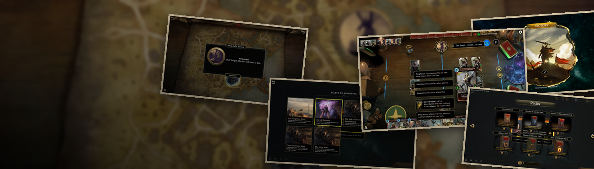
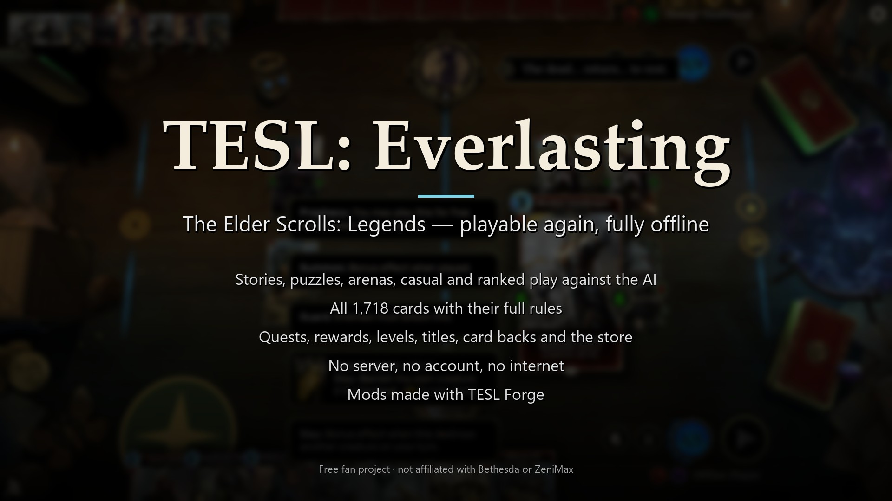
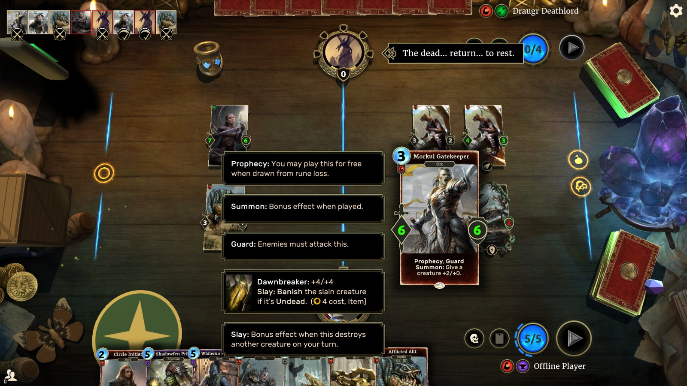
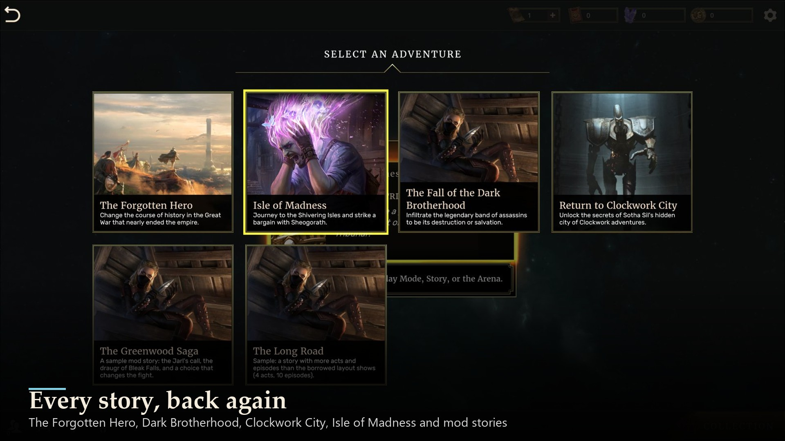
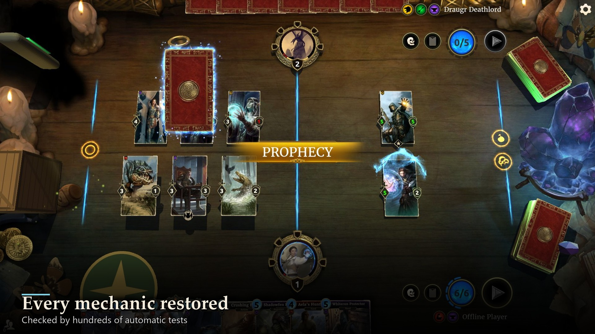
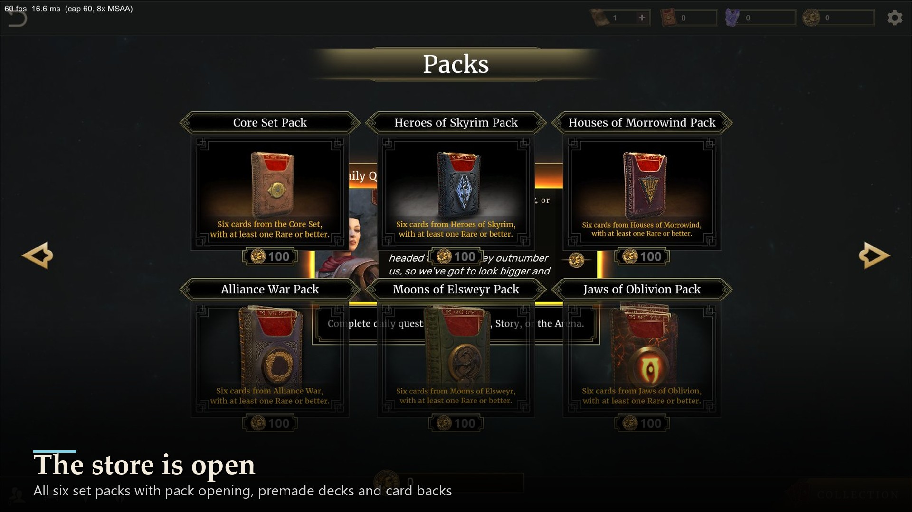
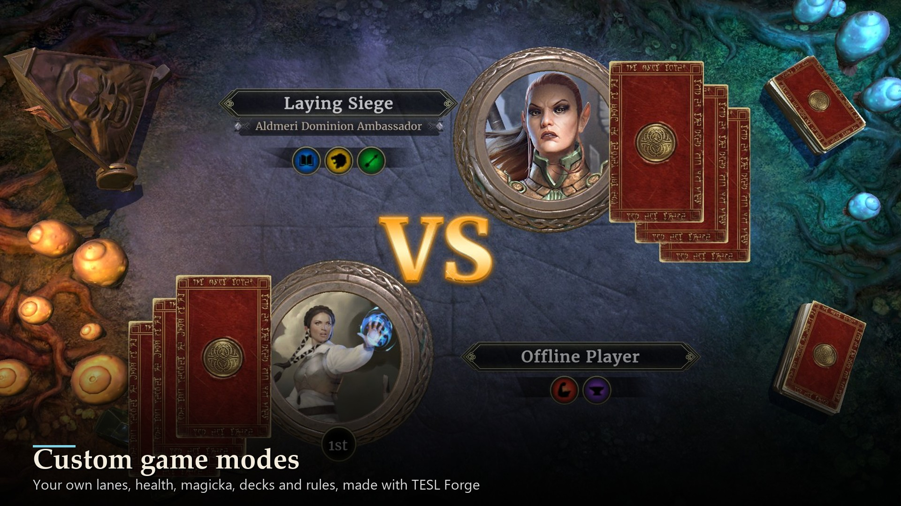
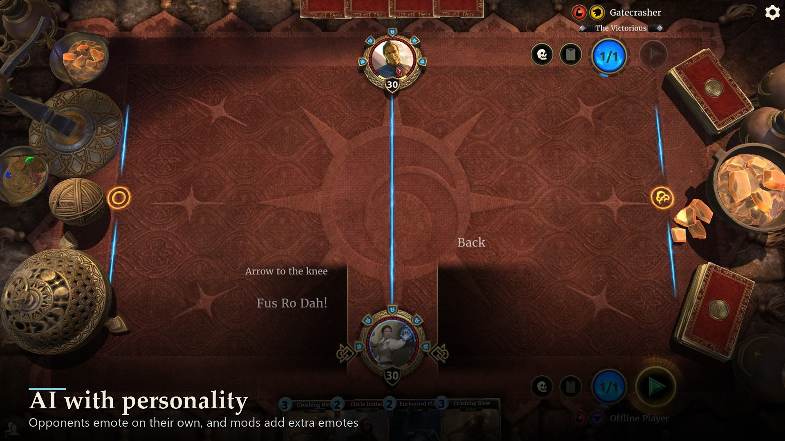
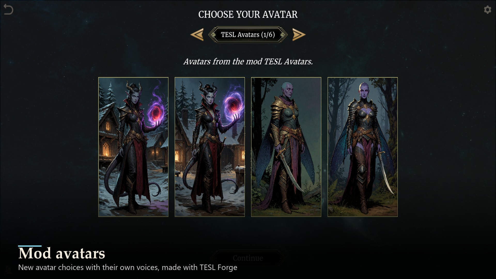

# TESL: Everlasting

**The Elder Scrolls: Legends, playable again.** TESL: Everlasting brings back the whole game in a complete, end-to-end
offline mode on your own PC: the stories, puzzles, arenas, casual and ranked play against the AI, quests, rewards,
levels, titles, the store and pack opening. Every one of the game's 1,718 cards plays with its full rules. No server, no
account, no internet.

It replaces the closed online services with a small local service that runs inside the game, plus a rules engine that
plays every match on your PC. The original game does the rest, with its own menus, animations, art, music and voices.

## Not affiliated

TESL: Everlasting, TESL Forge and our content mods are free fan projects. They are not affiliated with, endorsed by or
supported by Bethesda Softworks, ZeniMax Media, Microsoft, Dire Wolf Digital or Sparkypants, the makers of *The Elder
Scrolls: Legends*. *The Elder Scrolls*, *The Elder Scrolls: Legends* and all related names, characters and lore belong
to their owners.

## Features

**Play**
- The original first run: the tutorial battles, name entry, then the main menu.
- **Stories:** The Forgotten Hero, The Dark Brotherhood, Clockwork City and Isle of Madness, at Normal and Master
  difficulty, with their special lanes, scripted battles, dialogue, maps, choices and rewards.
- **Puzzles** with their original setups.
- **Practice, Casual and Ranked** against the AI (ladder, Serpent rank, seasons, monthly reward cards), **Solo Arena**
  and **Versus Arena**.
- An AI opponent that plays real decks and emotes with a personality of its own.

**Cards**
- **All 1,718 cards play with their full rules,** including Prophecy, runes, lanes, Betray, Exalt, Consume, Plot,
  Assemble, Mobilize, Invade, Treasure Hunt, Slay, double cards and linked cards.
- Card crafting and free deck building (optional, offline).

**Rewards and progression**
- Daily quests, Battle Victories, account levels 2–50 with their rewards, titles, card backs, gold, gems and tickets.
- **The store:** the set packs with pack opening, premade decks, card backs and story acts for gold.

**The F10 menu**
- Display and graphics: resizable window, windowed, maximized or fullscreen, quality presets up to Ultra, frame cap up to
  unlimited, VSync, anti-aliasing up to 8×, texture filtering up to 16×, an FPS counter.
- Switch between offline and online play (when TESL Reborn is installed).
- Practice settings, custom game modes and story options.
- **Optional cheats, offline against the AI only:** gold, gems and tickets; unlock all cards and decks; free deck
  building; and in-match help (magicka, draw, heal, restore a rune, win).

**Mods**
- Plays mods made with [TESL Forge](https://github.com/ArchAngelAries/tesl-forge): new cards with rules, decks, avatars and
  emotes, card backs, boards, music, sounds and voices, game modes, stories, AI opponents, card packs, translations and
  remastered art.
- Load order and compatibility checks: a broken mod item is skipped and reported instead of breaking the game.

## Fair play

Cheats, gameplay mods and AI-controlled players are for offline play against the in-game AI only. Online, TESL:
Everlasting loads only local visual and audio mods and graphics options. If a game running TESL: Everlasting's offline
code tries to join a remote match, it is closed immediately. No cheating against other players, by people or by AI.

## Works alongside TESL Reborn

TESL Reborn is a separate community project that brings back online play. Our tools work alongside it in the same game
folder: with it installed, the F10 menu switches between offline play and online play, and online launches use only
local visual and audio mods. We are not part of TESL Reborn and it has its own team, support and rules. **Please don't
contact the TESL Reborn team about our mods or tools**; report problems on our pages instead.

<!-- screenshots:start -->
## Screenshots

| | |
|---|---|
|  Main menu |  A match against the AI |
|  Every story campaign |  Prophecy, as in the original |
|  The store and pack opening |  Custom game modes from mods |
|  AI opponents that emote |  Mod avatars in the picker |

More in [docs/screenshots](docs/screenshots).
<!-- screenshots:end -->

## Requirements

- Windows 10 or 11.
- *The Elder Scrolls: Legends* for PC, installed (Steam or Bethesda.net launcher, final version).
- [BepInEx 5.4.23 (x86)](https://github.com/BepInEx/BepInEx/releases): included in the "with BepInEx" download. If your game
  folder already has BepInEx (TESL Reborn installs it), use the "plugin only" download.
- Optional: [TESL Forge](https://github.com/ArchAngelAries/tesl-forge) to make and manage mods.

## Installation

1. Back up the `.offline-user-data` folder in your game folder, if it exists.
2. Find your game folder (Steam: right-click the game > Manage > Browse local files).
3. Download **TESL-Everlasting-1.0.1-with-BepInEx.zip** if the game folder has no `BepInEx` folder yet, or
   **TESL-Everlasting-1.0.1.zip** (plugin only) if it does.
4. Extract the zip into the game folder, next to `The Elder Scrolls Legends.exe`. Install it by hand; mod managers such as
   Vortex don't support this game.
5. Double-click **Play TESL Everlasting.cmd** in the game folder (or start the game as usual). A new profile begins with
   the tutorial.
6. Press **F10** in the game for options.

**Uninstall:** delete `BepInEx\plugins\TESLOffline` and `BepInEx\patchers\TESLOffline` (and `Play TESL Everlasting.cmd`).
Your offline profile stays in `.offline-user-data` until you delete it. The player guides (getting started, F10 menu, FAQ,
troubleshooting) are inside `BepInEx\plugins\TESLOffline\docs`.

## Your copy of the game

You need *The Elder Scrolls: Legends* for PC installed. None of our downloads contain the game. We don't ask how anyone
came by their copy and we treat every player the same: we don't condone unofficial copies, and we don't condemn anyone
for playing an unofficial copy of a free-to-play game that its makers no longer offer or support.

## Independently developed

All code, tools and new assets were developed independently for these projects. Neither download includes the game.

## Made with AI tools

TESL: Everlasting and TESL Forge were built with **Claude Code** (Anthropic), which made these projects possible, together
with **ArchAngelAries**, who designed, directed and tested them. OpenAI's Codex helped with parts of the early engine work.
Program code, rules work and documentation were written this way; screenshots come from the game and the app themselves.

## Releases and development builds

Nexus Mods is the official home of releases. Development happens on GitHub, where the newest changes land first and every
release is published too: [TESL: Everlasting](https://github.com/ArchAngelAries/tesl-everlasting) ·
[TESL Forge](https://github.com/ArchAngelAries/tesl-forge).

## Shout-outs

- **Dire Wolf Digital, Sparkypants and Bethesda** for *The Elder Scrolls: Legends*.
- **crow2cr0w** ([tesl-offline](https://github.com/crow2cr0w/tesl-offline)) for publishing the original card rule data.
- **The UESP editors** and the **Legends Fandom wiki** editors for years of careful documentation.
- **The TESL Reborn team** for keeping online play alive, and a TESL Reborn developer who kindly helped with a reference
  installation.
- **BepInEx** and **HarmonyX** developers.
- Everyone who never stopped loving this game.

## License

Free for noncommercial use: PolyForm Noncommercial 1.0.0 with additional permissions (see `LICENSE`). Nobody may sell or
paywall TESL: Everlasting or versions of it. Mods you make for it are yours, including to sell, as long as they don't
contain our code; material that belongs to Bethesda stays theirs. Third-party parts: `NOTICE.md`.

## Support

Everything here is free and stays free. If you'd like to help:

- Ko-fi: https://ko-fi.com/archangelaries
- Patreon: https://www.patreon.com/c/ArchAngelAries

Report problems on the mod's Nexus page or on the GitHub issue trackers of
[TESL: Everlasting](https://github.com/ArchAngelAries/tesl-everlasting/issues) and
[TESL Forge](https://github.com/ArchAngelAries/tesl-forge/issues).
